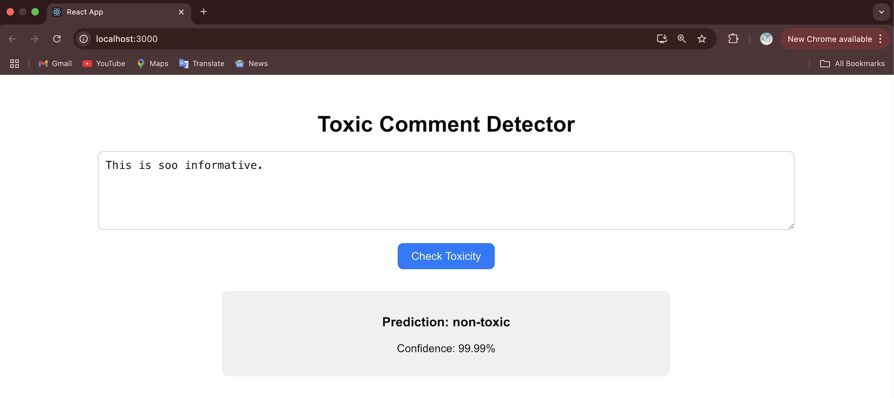
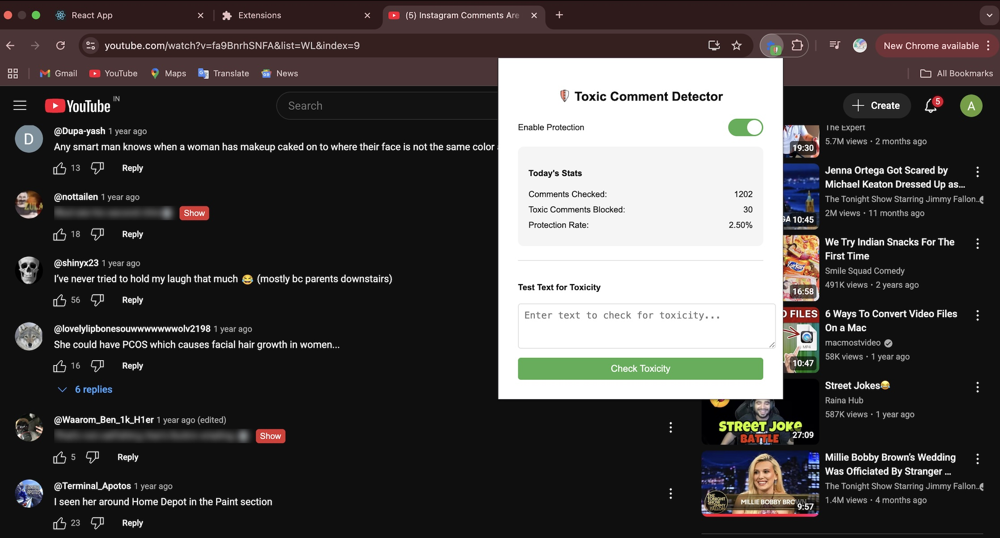

# 🧠 Toxic Comment Detection System

---

## 🔍 Overview
The **Toxic Comment Detection System** is an **AI-powered tool** that identifies **toxic and hate comments** in real time.  
It consists of:

- 🌐 **Web App** for checking individual comments  
- 🧩 **Chrome Extension** that **blurs toxic comments** on YouTube & Instagram  
- 🤖 **Custom BERT model** fine-tuned for English toxic comment detection

---

## 🚀 Live Demo & Downloads

### 🌐 **Try the Web App:**  
🔗 <a href="https://toxic-comment-detector-updated.onrender.com" target="_blank" rel="noopener noreferrer">Toxic Comment Detector Live</a>

### ▶️ **Complete Walkthrough (Youtube):**  
🔗 <a href="https://www.youtube.com/watch?v=wv8dsj2tdGo" target="_blank" rel="noopener noreferrer">Check out this video</a>

### 💻 **Download Chrome Extension ZIP:**  
🔗 <a href="https://drive.google.com/file/d/1tlcMZA7iFqsEo9a8n_oIAsJvzbtq2OAp/view?usp=drive_link" target="_blank" rel="noopener noreferrer">Download Extension</a>

🎥 **Chrome Extension Setup Tutorial (YouTube):**  
🔗 <a href="https://www.youtube.com/watch?v=MnTMe5dBzf8" target="_blank" rel="noopener noreferrer">How to Install & Use the Extension</a>

---

## 🧩 How to Use the Chrome Extension Locally

1. **Download** and **unzip** the extension file.  
2. Open **Chrome** → go to `chrome://extensions/`.  
3. Enable **Developer Mode** (top-right).  
4. Click **Load Unpacked** and select the **unzipped folder**.  
5. Visit **YouTube or Instagram** → Toxic comments will be **blurred automatically**.  
6. Click **Show** to reveal hidden comments if needed.

---

## 🌟 Key Highlights
- ✅ **Real-time** detection of toxic & hate comments  
- ⚡ **Fine-tuned BERT model** hosted via Flask backend  
- 🖥️ **Sleek and responsive UI** with probability scores  
- 🔒 **Chrome Extension** automatically blurs toxic comments on social media  
- 🌍 **Live & publicly accessible** via Render deployment  

---

## 🖼️ Screenshots

### 🌐 Web App

### 🧩 Chrome Extension in Action

---

## 🛠️ Tech Stack

| Layer             | Technology                                 |
|-------------------|--------------------------------------------|
| **Frontend**      | React.js, TailwindCSS, HTML                |
| **Backend**       | Flask (Python)                             |
| **ML Model**      | fine-tunned BERT (`transformers`)          |
| **Browser Ext.**  | JavaScript, Manifest v3                    |
| **Deployment**    | Render (Flask app), Hugging Face (Model)   |

---

## 📖 Usage Guide

### 🌍 Web App
1. Enter any text or comment in the input box.
2. Click **"Check Toxicity"**.
3. Instantly see **prediction** (Toxic / Not Toxic) and **confidence score**.

### 🧩 Extension
- Visit YouTube or Instagram.
- Toxic comments will be blurred automatically.
- You can also unhide the blurred comment on your wish.

---

## 📚 Acknowledgments
- 🤗 **Hugging Face** for BERT model & transformers library  
- 🐍 **Flask** for serving ML model as API  
- ⚛️ **React.js & TailwindCSS** for the responsive frontend  
- 🌐 **Google Chrome** for extension support  

---

## ⭐ Pro Tip
> Blurring toxic comments while browsing makes the internet **a calmer place**.  
> Give it a try and enjoy **clean social media feeds**! ✨

---

### 🏆 Star this repo if you like it!  
It helps more people discover this project 🚀

